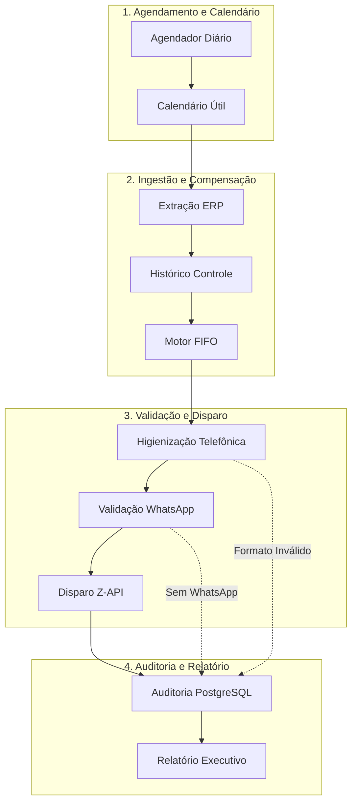

# Cobrança Preventiva

Orquestração financeira em n8n para cálculo de saldo líquido (compensação FIFO de créditos sobre débitos), validação prévia de contas WhatsApp, disparo preventivo (`D-10` e `D-5`) com repescagem automática e reporte executivo em Excel (`.xlsx`).


---

## 1. Visão Rápida

| Eixo | Especificação Técnica |
| :--- | :--- |
| **Entrada** | Gatilho `Cron` em dias úteis (`17h00`), calendário nacional via `BrasilAPI` e extração `CTE` no ERP Oracle (`VW_ERP_CONTAS_RECEBER`, `ERP_PARCEIROS`, `ERP_CLIENTES_LOJA`). |
| **Processamento** | Abatimento cronológico `FIFO` de créditos (`C`) sobre débitos (`D`), cálculo de janela útil (`D-10`/`D-5` + repescagem automática), seleção telefônica multi-coluna em 3 níveis e checagem `/phone-exists`. |
| **Saída** | Cobrança consolidada via `Z-API` (`/send-text`), persistência transacional `UPSERT` no PostgreSQL (`"AUTOMATION"."AVIS_COBR"` e `"COBR_HIST"`), planilha `.xlsx` por e-mail e telemetria. |

---

## 2. Arquitetura do Fluxo



- **Compensação Financeira FIFO:** Soma adiantamentos/créditos (`C`) em aberto do cliente e abate cronologicamente sobre os vencimentos de débito (`D`), cobrando apenas o saldo devedor líquido resultante.
- **Seleção Telefônica Multi-Coluna (Anatel):** Avalia `TEL1_TRA`, `TEL2_TRA` e `CFO1_TRA`, remove zeros à esquerda do DDD e prioriza celular de 9 dígitos nativo (Tier 1) > celular de 8 dígitos padronizado (Tier 2) > fixo (Tier 3).
- **Prevenção de Falso Positivo (`/phone-exists`):** Consulta a existência da conta no WhatsApp antes do disparo, classificando fixos ou números inativos como `SEM_WHATSAPP` sem consumir fila nem expor a instância a bloqueios.
- **Idempotência ACID e Repescagem Automática:** Chave única `CLIENTE_VENCIMENTO_ETAPA` impede duplicidade de `ENVIADO` e reprocessa automaticamente `PENDENTE`, `SEM_WHATSAPP` e `NAO_ENTREGUE` nos dias úteis subsequentes da janela.
- **Cadência Anti-Banimento:** Simulação de digitação (`delayTyping` de 4s a 8s) combinada com espera aleatória (`15s` a `35s`) entre clientes processados em lote unitário.

---

## 3. Stack & Integrações

| Componente | Tecnologia / Nó n8n | Papel na Arquitetura |
| :--- | :--- | :--- |
| **Orquestrador** | `n8n` (`Schedule v1.2`, `Code v2`, `SplitInBatches v3`) | Agendamento `Cron`, motor de regras financeiras `FIFO`, controle de lote e geração `.xlsx`. |
| **Fonte Financeira** | `Oracle ERP` (`Oracle Database with Parameterization v1`) | Leitura `Read-Only` de títulos em aberto (`D`/`C`), filial (`CODI_EMP`) e telefones cadastrais. |
| **Estado & Auditoria** | `PostgreSQL` (`n8n-nodes-base.postgres v2.7`) | Controle de idempotência/repescagem (`"AUTOMATION"."AVIS_COBR"`) e trilha imutável (`"COBR_HIST"`). |
| **Calendário Útil** | `BrasilAPI` (`n8n-nodes-base.httpRequest v4.2`) | Consulta de feriados nacionais com fallback estático local para cálculo de dia útil anterior. |
| **Mensageria WhatsApp** | `Z-API` (`n8n-nodes-base.httpRequest v4.2`) | Validação prévia de conta ativa (`/phone-exists`) e envio de mensagem consolidada (`/send-text`). |
| **Reporte & Telemetria** | `Microsoft Outlook v2` + `Execute Workflow v1.3` | Disparo do resumo HTML com anexo `.xlsx` para a operação e chamada de subworkflow de observabilidade. |

---

## 4. Como Rodar (Setup Rápido)

> [!IMPORTANT]
> Configure previamente no n8n as credenciais **`Oracle_ERP_Read`** (Oracle Database), **`PostgreSQL_Main`** (Postgres) e **`Microsoft_Outlook_Corporate`** (Microsoft Outlook OAuth2). Caso utilize variáveis via `$env`, garanta que a instância n8n esteja com `N8N_BLOCK_ENV_ACCESS_IN_NODE=false`.

```env
# Gateway WhatsApp (Z-API)
ZAPI_INSTANCE_ID=your_zapi_instance_id
ZAPI_INSTANCE_TOKEN=your_zapi_instance_token
ZAPI_CLIENT_TOKEN=your_zapi_client_token

# Parâmetros Operacionais e Calendário Local
FINANCE_SUPPORT_PHONE=(00) 90000-0000
LOCAL_HOLIDAYS_JSON=["2026-11-20"]

# Destinatários e Identidade Visual do Relatório Executivo
REPORT_TO_RECIPIENTS_JSON=[{"nome":"Equipe Financeira","email":"financeiro@empresa.exemplo.com"}]
REPORT_BCC_RECIPIENTS_JSON=[{"nome":"Auditoria Operacional","email":"auditoria@empresa.exemplo.com"}]
BRAND_ASSETS_BASE_URL=https://assets.empresa.exemplo.com/email
```

1. **Provisionar Banco de Controle:** Execute o script DDL (seção abaixo) no banco `PostgreSQL_Main` para criar o schema `"AUTOMATION"` e as tabelas `"AVIS_COBR"` e `"COBR_HIST"`.
2. **Importar Workflow:** No n8n, importe `rep/fluxo.json` e vincule as credenciais `Oracle_ERP_Read`, `PostgreSQL_Main` e `Microsoft_Outlook_Corporate`.
3. **Configurar Subworkflows:** Substitua os placeholders `{{WORKFLOW_ID_OBSERVABILITY}}` (nó `21. Registrar Telemetria`) e `{{WORKFLOW_ID_ERROR_HANDLER}}` (configurações do fluxo) pelos IDs da sua instância.
4. **Homologar em Modo Seguro:** No nó `02. Parâmetros Globais`, defina uma `data_simulacao_iso` (`YYYY-MM-DD`) para validar a agenda calculada antes de ativar o agendamento diário.

---

## 5. Aprofundamento Técnico

<details>
<summary>📦 Payload de exemplo (mock seguro) & DDL PostgreSQL</summary>

### Mock de Retorno do ERP (`06. Extrair Títulos`)
```json
{
  "rows": [
    {
      "CODI_TRA": 1001,
      "RAZA_TRA": "CLIENTE EXEMPLO COMERCIAL LTDA",
      "CODI_EMP": 1,
      "TEL1_TRA": "(011) 98888-7777",
      "TEL2_TRA": "11 3333-4444",
      "CFO1_TRA": "",
      "CODI_TDO": 101,
      "TIPO_TDO": "D",
      "CODI_TCO": 1,
      "COD1_PES": 10,
      "DATA_CBR": "2026-10-01",
      "VENC_REC": "2026-11-16",
      "VLOR_REC": 2500.00,
      "VLAB_REC": 2500.00,
      "SALDO_ABERTO": 2500.00
    },
    {
      "CODI_TRA": 1001,
      "RAZA_TRA": "CLIENTE EXEMPLO COMERCIAL LTDA",
      "CODI_EMP": 1,
      "TEL1_TRA": "(011) 98888-7777",
      "TEL2_TRA": "11 3333-4444",
      "CFO1_TRA": "",
      "CODI_TDO": 102,
      "TIPO_TDO": "C",
      "CODI_TCO": 1,
      "COD1_PES": 10,
      "DATA_CBR": "2026-10-10",
      "VENC_REC": "2026-10-10",
      "VLOR_REC": 500.00,
      "VLAB_REC": -500.00,
      "SALDO_ABERTO": 500.00
    }
  ]
}
```

### DDL Mínimo (`"AUTOMATION"."AVIS_COBR"` e `"AUTOMATION"."COBR_HIST"`)
```sql
CREATE SCHEMA IF NOT EXISTS "AUTOMATION";
CREATE EXTENSION IF NOT EXISTS pgcrypto;

CREATE TABLE IF NOT EXISTS "AUTOMATION"."AVIS_COBR" (
    "IDEN_COBR" UUID PRIMARY KEY DEFAULT gen_random_uuid(),
    "CHAV_COBR" VARCHAR(120) NOT NULL UNIQUE,
    "CLIE_COBR" BIGINT NOT NULL,
    "RAZA_COBR" VARCHAR(255) NOT NULL,
    "TELO_COBR" VARCHAR(60),
    "TELE_COBR" VARCHAR(30),
    "VENC_COBR" DATE NOT NULL,
    "ETAP_COBR" VARCHAR(10) NOT NULL CHECK ("ETAP_COBR" IN ('D-10', 'D-5')),
    "DTNT_COBR" DATE NOT NULL,
    "DTNE_COBR" DATE NOT NULL,
    "ANTE_COBR" BOOLEAN NOT NULL DEFAULT FALSE,
    "PROR_COBR" BOOLEAN NOT NULL DEFAULT FALSE,
    "VEAN_COBR" DATE,
    "QTIT_COBR" INTEGER NOT NULL DEFAULT 1,
    "VLBR_COBR" NUMERIC(15,2) NOT NULL DEFAULT 0,
    "CRAB_COBR" NUMERIC(15,2) NOT NULL DEFAULT 0,
    "VLCO_COBR" NUMERIC(15,2) NOT NULL DEFAULT 0,
    "SLDD_COBR" NUMERIC(15,2) NOT NULL DEFAULT 0,
    "SLDC_COBR" NUMERIC(15,2) NOT NULL DEFAULT 0,
    "SLDG_COBR" NUMERIC(15,2) NOT NULL DEFAULT 0,
    "STAT_COBR" VARCHAR(30) NOT NULL DEFAULT 'PENDENTE'
        CHECK ("STAT_COBR" IN ('ENVIADO', 'SEM_WHATSAPP', 'NAO_ENTREGUE', 'FALHA_TELEFONE', 'PENDENTE')),
    "TENT_COBR" INTEGER NOT NULL DEFAULT 1,
    "ERRO_COBR" VARCHAR(100),
    "DETA_COBR" TEXT,
    "ZAPI_COBR" VARCHAR(150),
    "MENS_COBR" TEXT,
    "CREA_COBR" TIMESTAMPTZ NOT NULL DEFAULT NOW(),
    "UPDA_COBR" TIMESTAMPTZ NOT NULL DEFAULT NOW(),
    "DELE_COBR" TIMESTAMPTZ,
    "USCR_COBR" VARCHAR(50) NOT NULL DEFAULT 'svc_n8n_init',
    "USAL_COBR" VARCHAR(50) NOT NULL DEFAULT 'svc_n8n_automation'
);

CREATE TABLE IF NOT EXISTS "AUTOMATION"."COBR_HIST" (
    "IDEN_HIST" UUID PRIMARY KEY DEFAULT gen_random_uuid(),
    "IDEN_COBR" UUID REFERENCES "AUTOMATION"."AVIS_COBR"("IDEN_COBR") ON DELETE SET NULL,
    "CHAV_HIST" VARCHAR(120) NOT NULL,
    "EXEC_HIST" VARCHAR(100),
    "CLIE_HIST" BIGINT NOT NULL,
    "VENC_HIST" DATE NOT NULL,
    "ETAP_HIST" VARCHAR(10) NOT NULL,
    "VLCO_HIST" NUMERIC(15,2) NOT NULL DEFAULT 0,
    "STAT_HIST" VARCHAR(30) NOT NULL,
    "ERRO_HIST" VARCHAR(100),
    "DETA_HIST" TEXT,
    "ZAPI_HIST" VARCHAR(150),
    "PAYL_HIST" JSONB,
    "CREA_HIST" TIMESTAMPTZ NOT NULL DEFAULT NOW(),
    "UPDA_HIST" TIMESTAMPTZ NOT NULL DEFAULT NOW(),
    "DELE_HIST" TIMESTAMPTZ,
    "USCR_HIST" VARCHAR(50) NOT NULL DEFAULT 'svc_n8n_init',
    "USAL_HIST" VARCHAR(50) NOT NULL DEFAULT 'svc_n8n_automation'
);
```
</details>

<details>
<summary>🛡️ Segurança, resiliência e limitações conhecidas</summary>

- **Resiliência de Rede e Banco:** Nós críticos (`Oracle`, `PostgreSQL` e `Microsoft Outlook`) operam com `retryOnFail: true` (`maxTries: 3`). A consulta à `BrasilAPI` possui `onError: continueRegularOutput` apoiada por lista estática de feriados nacionais fixos no nó `04. Validar Calendário`.
- **Isolamento de Falhas no Gateway WhatsApp:** Erros HTTP (`statusCode >= 400`) ou indisponibilidade da Z-API no endpoint `/phone-exists` são diferenciados de respostas explícitas `exists: false`, evitando que quedas momentâneas da instância marquem números válidos como `SEM_WHATSAPP`.
- **Detecção de Prorrogação Sem Falsos Positivos:** O motor identifica prorrogação real apenas quando o vencimento futuro anteriormente notificado deixa de existir em aberto na carteira do cliente e dá lugar a uma data postergada.
- **Limitação Conhecida (Interpolação SQL no Nó Postgres):** O nó `17. Registrar Auditoria` utiliza `executeQuery` com sanitização manual de aspas simples (`.replace(/'/g, "''")`). Em evoluções futuras, recomenda-se migrar para *Query Parameters* (`$1, $2, ...`) nativos do nó PostgreSQL.
</details>
